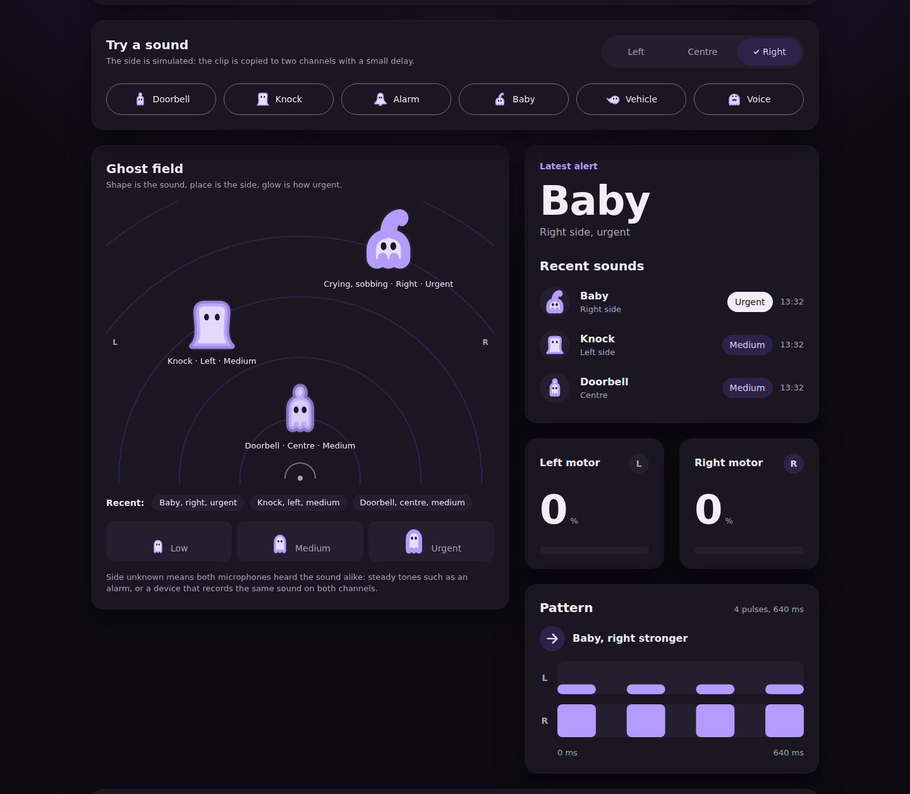
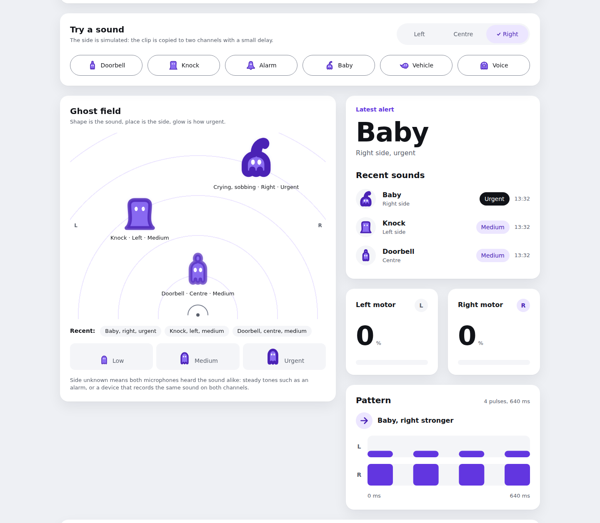
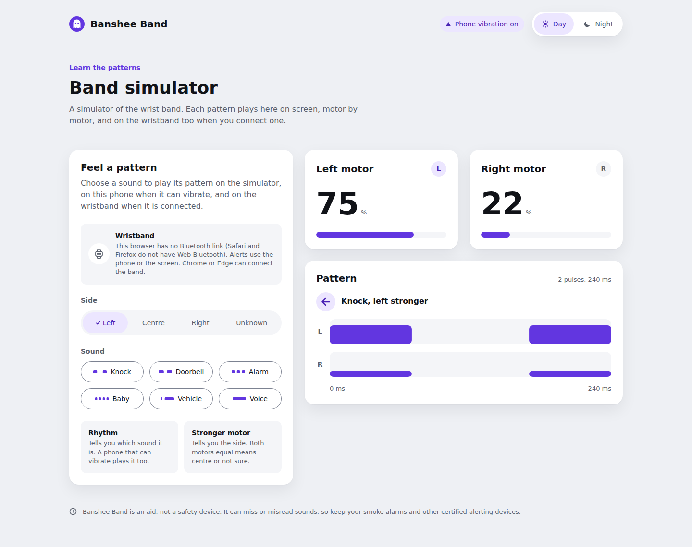
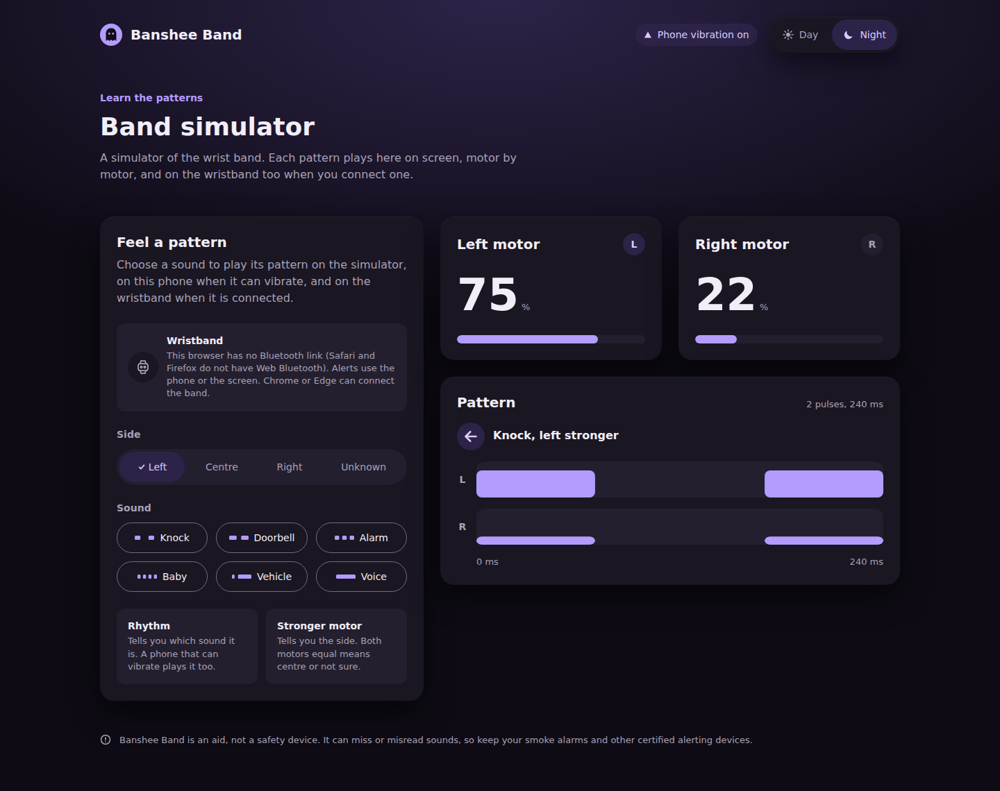
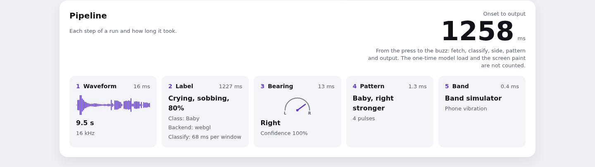
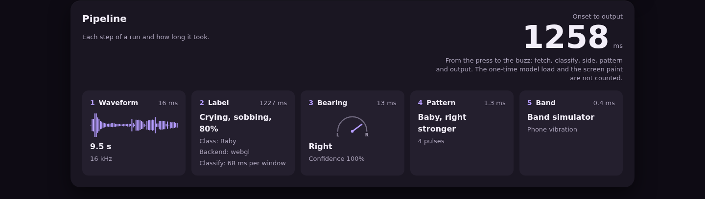
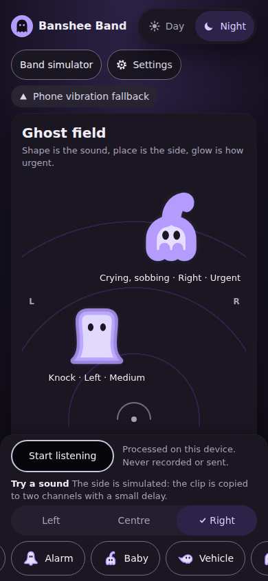

# Banshee Band

Sounds you cannot hear, felt on your wrist and seen as ghosts that point to where they came from.

Built for [Kiroween 2026](https://kiroween.devpost.com/), Frankenstein category: a Google sound model, a hand-written direction finder, Web Bluetooth, an ESP32 sketch and an MCP server, stitched into one browser app. Submissions close 2026-12-04.

**Banshee Band is an aid, not a safety device.** It can miss a sound or name it wrongly. Keep your smoke alarms and any certified alerting devices.



Screenshots of the production build served by the Docker image (`docker run -p 4173:4173 banshee-band`), Chromium at 1440 px and 390 px, after pressing Doorbell (Centre), Knock (Left) and Baby (Right) in **Try a sound**.

| | Day | Night |
|---|---|---|
| Ghost field |  |  |
| Band simulator |  |  |
| Pipeline |  |  |

On a 390 px phone in Night the ghost field comes first and Start listening and the sample chips sit in a bar at the bottom of the screen within thumb reach.



## What it is

A listening station that runs in the browser, for people who are Deaf or hard of hearing. It listens through the device microphones, names the sound with the YAMNet model, estimates which side it came from, and tells you two ways:

- **On screen**, each sound appears as a ghost. Its shape shows the class, its place shows the side and its glow shows the urgency. A "Now:" list and a Latest alert say the same in words.
- **On the wrist**, each class has its own vibration rhythm, stronger on the side the sound came from. It plays on phone vibration, on the on-screen band simulator, or on a DIY two-motor ESP32 wristband over Web Bluetooth (Chrome and Edge only).

There are seven sound classes, the same as the event contract in `src/events`: `knock`, `doorbell`, `alarm`, `baby`, `vehicle`, `voice` and `other`. Six of them have a vibration pattern; `other` (music, silence, anything else) shows a ghost but never buzzes. You choose which classes alert and how loud they must be. All audio stays on the device: nothing is uploaded, and no audio is stored.

Without a microphone, **Try a sound** plays one of six sample clips through the same pipeline, from the left, the centre or the right.

## Quick start

Needs [bun](https://bun.sh) and a Chromium-based browser for the wristband.

```sh
bun install
bun run dev          # http://localhost:5173
```

Open http://localhost:5173, press a **Try a sound** chip, or **Start listening** and allow the microphone. The band simulator is at http://localhost:5173/band.html and the design system at http://localhost:5173/styleguide.html.

| Command | What it does |
|---|---|
| `bun run dev` | Vite dev server on http://localhost:5173 |
| `bun run typecheck` | `tsc --noEmit` (strict) |
| `bun run test` | Vitest unit and property tests, once |
| `bun run build` | Type check, then static build to `dist/` with the service worker |
| `bun run e2e` | Playwright tests: starts the dev server on port 5287 and a production build with `vite preview` on port 5288; screenshots go to `e2e/screenshots/`. Run `bunx playwright install chromium` once first |
| `bun run mcp:banshee-log` | Starts the `banshee-log` MCP server on stdio (see [MCP server](#mcp-server)) |
| `bun run log:seed` | Replays every sample clip from the left, centre and right through the real pipeline and appends the 18 events to the sound log |
| `bun run classify:report` | Runs YAMNet (TF.js CPU) over the six clips and rewrites `tests/classify/clip-results.json` |
| `bun run bearing:report` | Runs the seeded direction cases and rewrites `tests/bearing/accuracy.json` and `docs/bearing.md` |
| `bun run bearing:mutate`, `bun run haptics:mutate` | Break the code on purpose, one change at a time, and check that a test catches each change |
| `bun run hooks:patterns`, `bun run hooks:spec-tests`, `bun run hooks:colour`, `bun run hooks:fixtures` | The four checks behind the Kiro hooks (see [Kiro hooks](#kiro-hooks)) |
| `bun run icons` | Regenerates `public/icons/*.png` and `public/manifest.webmanifest` from code (same bytes every run; the output is committed) |

### Run in Docker

Needs only Docker. The `Dockerfile` installs from `bun.lock` in a clean Linux box and has two targets.

**Serve the app** (the default target): it builds the production app and serves it with `vite preview` on `0.0.0.0`, port 4173 (set `PORT` to change it). No key, no account; the YAMNet model and the six sample clips are in the image.

```sh
docker build -t banshee-band . && docker run --rm -p 4173:4173 banshee-band
# or: bun run docker:serve
```

Then open http://localhost:4173 and press a **Try a sound** chip. The band simulator is at http://localhost:4173/band.html. The microphone needs `localhost` or HTTPS, so open it on the same machine (or put HTTPS in front of it).

**Run the tests** (the `test` target): `bun run typecheck`, `bun run build`, `bun run test` and `bun run e2e` (Chromium from the Playwright image). It stops at the first failure, prints every e2e result as a list and ends with `GATE PASSED` or `GATE FAILED`.

```sh
docker build --target test -t banshee-band-test . && docker run --rm --ipc=host banshee-band-test
# or: bun run docker:test
```

## How it works

```
microphone (stereo, getUserMedia, no echo cancel / noise suppression / AGC)
   or a sample clip (16 kHz mono WAV, turned into a simulated stereo pair for the chosen side)
        |
  AudioWorklet tap --> resample to 16 kHz mono --> 15600-sample windows (0.975 s, 50% overlap)
        |                                                   |
  stereo blocks of 1024                              YAMNet (TensorFlow.js, WebGL in the browser)
        |                                                   |
  GCC-PHAT delay between the two mics,               521 AudioSet scores --> rules --> one of 7 classes
  level difference as a fallback                     (max per class, threshold 0.15)
        \                                                  /
         `--------------> SoundEvent (src/events) <-------'
                          class, label, confidence, bearing, bearing source, loudness, urgency
                                     |
                       Settings (class on/off, loudness level)
                                     |
                       haptic engine: pattern per class, side from bearing,
                       priority, 3 s rate limit per class
                          /                |                     \
               ghost field (canvas)   phone vibration     wristband frame over Web Bluetooth
               + "Now:" list           or band simulator   (ESP32, two motors)
```

- `src/audio` captures the microphone or a clip and frames it. `src/classify` loads YAMNet once and maps its 521 AudioSet labels to the seven classes by exact name (`src/classify/rules.ts`). `src/bearing` estimates the side with GCC-PHAT and falls back to the loudness difference, or reports "unknown" when both microphones carry the same signal. `src/haptics` turns an event into a vibration command. `src/band` plays it on one of three outputs behind one interface. `src/ghosts` draws the ghosts on a 2D canvas. `src/station` wires it into the page.
- Urgency comes from the class: `alarm` and `baby` are high; `doorbell`, `knock` and `vehicle` medium; `voice` and `other` low.
- Two microphones tell left from right, not front from back. Many laptops and phones give the same signal on both channels; then the side is "unknown", not "ahead".
- A production build is an installable web app that works offline after one visit (see [Install and offline](#install-and-offline)).

## Measured numbers

Every number here comes from a script or test in this repo, run on the development PC (Windows, WSL2). None is from a phone, a real room or a user test.

**Classification** (`bun run classify:report`, `tests/classify/clip-results.json`; Node, `@tensorflow/tfjs` 4.22.0 on the `cpu` backend, threshold 0.15). All 6 of 6 clips get their class; mean frame accuracy 0.7778 over 70 windows. Two pass narrowly: `knock-01` (6 knock windows, 5 silence between knocks) and `alarm-smoke-01` (5 alarm, 4 voice: there is quiet speech in the room after the alarm stops). Six clips are a regression check, not an accuracy figure. Details in `docs/yamnet.md`.

| Clip | Class | Windows | Frame accuracy | Top label |
|---|---|---|---|---|
| `doorbell-01` | `doorbell` | 6 | 1.0 | Doorbell |
| `knock-01` | `knock` | 11 | 0.5455 | Knock |
| `alarm-smoke-01` | `alarm` | 11 | 0.4545 | Smoke detector, smoke alarm |
| `baby-cry-01` | `baby` | 18 | 1.0 | Crying, sobbing |
| `vehicle-horn-01` | `vehicle` | 6 | 0.6667 | Vehicle horn, car horn, honking |
| `voice-speech-01` | `voice` | 18 | 1.0 | Speech |

**Direction** (`bun run bearing:report`, `docs/bearing.md`). 244 seeded synthetic cases, 0 miss their rule. At 48 kHz with an assumed 8 cm microphone spacing: white noise at 20 dB SNR, mean error 0.23°, worst 0.95°; at 0 dB SNR, mean 0.43°, worst 1.03°. A clap-like set of 1008 windows at 10 dB: 99.90% within 4°, worst 4.47°. Pure tones are the weak spot (worst 21° at 0 dB, reported at low confidence). These are synthetic signals, not rooms.

**Latency** (`e2e/latency.spec.ts`, headless Chromium, TF.js `webgl` backend): onset to output median **814 ms** for Try a sound on the 6.3 s knock clip (whole-clip processing, 11 windows), and **70 ms** for listening on a fake microphone. See [Latency](#latency) for what is and is not counted.

**Tests**: 1286 Vitest unit and property tests in 102 files, and 131 Playwright end-to-end tests in Chromium (one of them against the production build, offline), all passing when this was written. `tests/readme.test.ts` checks this README against the code: the seven classes, the commands, the credits for every clip and the files under `.kiro`.

**Size**: the YAMNet model is about 16 MB; the service worker caches about 18 MB in all at the first visit.

## The station

### Install and offline

The station is an installable web app. A production build (`bun run build`) writes a service worker, `dist/sw.js`, that caches the pages, the scripts, the YAMNet model and the sample clips at the first visit. After that one online visit the station opens, classifies and listens with no network, and the title block says "Works offline after the first visit." Your browser's install or "Add to Home Screen" option installs it. The dev server never registers the worker, so offline only works from a production build. For the same reason the offline test (`e2e/offline.spec.ts`) runs against the production build on port 5288, and `tests/pwa/build.test.ts` checks `dist/sw.js` after `bun run build` (it is skipped with a message when `dist/` is missing).

### Onboarding

The first visit opens a short three-step intro over the station: what Banshee Band does, that it is an aid and not a safety device, an Allow microphone button that runs the normal Start listening (the sample clips still work if the microphone is blocked or missing), and where alerts buzz (phone, screen or the DIY wristband). Skip intro or Escape closes it; it shows once (flag `banshee-band.onboarded.v1` in `localStorage`), and Settings has "Show intro again".

### Settings

The Settings pill in the station header opens a sheet: switch each sound class on or off, set how loud it must be to alert (−80 to −10 dB, default −50 dB), and choose where the buzz goes (phone vibration, screen only or the wristband). Changes apply at once, in Try a sound and while listening, and are saved in this browser's `localStorage` only.

### Wristband

The wristband is an ESP32 with two vibration motors, one on each side of the wrist. Press **Connect band** in Settings (under Buzz on) or on the band simulator page and pick the band in the browser's chooser; from then on each alert is sent to it as a short byte frame, and it buzzes the pattern stronger on the side the sound came from. The band only plays what it is sent; it does not listen or store anything. If it drops, the screen takes over at once.

The link uses Web Bluetooth, so it works in Chrome and Edge only. Safari and Firefox do not have it; there the Wristband option is disabled and the phone or the screen is used instead.

Parts, wiring, flashing and the byte protocol are in [firmware/README.md](firmware/README.md). **Honest note: the firmware has never been compiled, flashed or tried on a real band.** No ESP32 was used in this build. The browser side is tested against a mocked `navigator.bluetooth`, and a test checks that the sketch uses the same constants as `src/band/protocol.ts`.

The design system lives in `design/DESIGN.md` and `src/ui/tokens.css`.

## Accessibility

The people this is for are Deaf and hard of hearing, so accessibility is checked on every run of the end-to-end tests. `e2e/a11y.spec.ts` checks:

- an axe audit (`@axe-core/playwright`, the `wcag2a`, `wcag2aa` and `wcag21aa` rules, none turned off) of the station empty, the station with events, ghosts and the pipeline card, the Settings sheet, each of the three intro steps, `band.html` and `styleguide.html`, in Day and in Night. A violation fails the test. In Night the page is checked a second time with the background glow flattened to its brightest colour, because axe cannot measure text over a gradient;
- the keyboard: the Tab order of the station, a visible focus ring on every stop, Tab and Shift+Tab staying inside the Settings sheet and the intro, Escape closing them and returning the focus, Start listening with Enter and Space, a Settings switch with Space and a loudness slider with the arrow keys;
- reduced motion: with `prefers-reduced-motion: reduce`, no animation or transition on the ghost field, the status pills, the Settings sheet or the intro;
- announcements: each new sound is said once, politely, by the Latest alert, with its class, side and urgency in words, and nothing on the station or `band.html` is `assertive` or `role="alert"`.

`bun run hooks:colour` checks that no state is told apart by colour alone. Run everything with `bun run e2e`, or only these checks with `bunx playwright test e2e/a11y.spec.ts`.

Limits, honestly: axe finds only part of the WCAG problems, and a passing audit is not a claim of WCAG conformance or of any certification. There has been no testing with screen-reader users yet, and no testing with Deaf or hard-of-hearing users. The ghosts are drawn on a canvas, so axe checks only the canvas's name; a screen reader gets them through the "Now:" list and the canvas label instead.

## Latency

The pipeline card shows **Onset to output**: the measured time from the start of a sound to the moment its vibration pattern is handed to the outputs. It is read from `performance.now()` in the page, not estimated.

Measured with `e2e/latency.spec.ts` (Knock, one test at a time, `--repeat-each=5 --workers=1`) in headless Chromium from Playwright, dev server, on the development PC under WSL2; TensorFlow.js reported the `webgl` backend:

| Path | Five runs (ms) | Median |
|---|---|---|
| Try a sound, `knock-01.wav` (6.3 s clip) | 795.8, 899, 813.8, 828.8, 743.6 | 814 ms |
| Listening, fake microphone playing the same clip | 57.1, 58.6, 77.4, 74.3, 69.8 | 70 ms |

With the whole e2e suite running in parallel the same tests read about 1130 ms and 110 to 130 ms. A phone will differ.

What onset means:

- **Try a sound**: the start of the run, right after the chip press once the model is loaded. It counts fetching the clip and classifying every 0.975 s window of it (11 for this clip), then the side, the pattern and the output. The clip is processed faster than real time, so this is processing time on a whole clip, not a live delay. The one-time model load on the first press is not counted.
- **Listening**: the moment a 0.975 s microphone window reaches the page, which is the end of that window. It counts any wait behind a classification still running, then classify, side, pattern and output.

Output is the moment the last output's `play()` returned: the band simulator and phone vibration start then; for the wristband the frame has been queued for the Bluetooth write.

Not counted: the model load; the microphone, operating system and Web Audio buffering before a window reaches the page; the time the sound sat inside its window before the window ended (up to 0.975 s); the screen paint; the Bluetooth radio time and the motor spin-up. When nothing buzzed (the sound was muted in Settings or has no pattern) the card says so and shows no number.

## MCP server

`banshee-log` lets an agent such as Kiro or Claude Code ask what was heard and try a sound, offline, with no key. It runs with Bun over stdio (`mcp/banshee-log.ts`, built on `@modelcontextprotocol/sdk` with zod input schemas).

**The log.** The station is a browser app: it saves only its settings and never writes events to disk. So the server reads its own local log, a JSONL file at `BANSHEE_LOG`, by default `.banshee/events.jsonl` in the folder it runs from (gitignored). Each line is one event in the same shape as `src/events` (class, label, confidence, bearing, bearing source, loudness, urgency, with `t` in epoch ms), plus the `clip` and `side` it came from. Lines that are not valid events are skipped and counted. `bun run log:seed` fills it from the sample clips; `replay_clip` with `append: true` adds one event. The log holds event data only, never audio.

| Tool | What it does |
|---|---|
| `recent_events` | Newest events first. Optional `limit` (1 to 100, default 10), `class` (knock, doorbell, alarm, baby, vehicle, voice, other) and `since` (epoch ms). |
| `event_stats` | Counts per class, urgency and bearing source, mean confidence per class, first and last time and the loudest event. Optional `since`. |
| `replay_clip` | Runs a sample clip (`knock-01`, `doorbell-01`, `alarm-smoke-01`, `baby-cry-01`, `vehicle-horn-01`, `voice-speech-01`) through the same code as Try a sound: YAMNet on the TensorFlow.js CPU backend, the GCC-PHAT side estimate on a simulated stereo pair for `side` (left, centre or right), and the haptic engine. Returns the event, the pattern it would buzz, the bearing and the stage times. Nothing buzzes. The first call loads the model (a few seconds). `append: true` also writes the event to the log. |

Bad input (a `limit` of 0, an unknown class, an unknown clip) comes back as an error result, not a crash; an unknown clip lists the known ones.

Run it with `bun run mcp:banshee-log`. It is registered for Kiro in `.kiro/settings/mcp.json` (`recent_events` and `event_stats` auto-approved; `replay_clip` asks, because it can write), so opening this repo in Kiro should start it. To add it to another client, use the command `bun` with the arguments `run mcp:banshee-log`, run from the repo root, and set `BANSHEE_LOG` to point at another log file if you like.

`tests/mcp/banshee-log.test.ts` spawns the server over stdio and calls every tool, including the bad-input cases; `tests/mcp/log.test.ts` covers the log file itself.

## Built with Kiro

Kiro was used as the spec-and-steering author for the whole build, through `kiro-cli` in a terminal (`kiro-cli chat --no-interactive --trust-tools=fs_read,fs_write "<prompt>"`). The files under `.kiro/` were written by `kiro-cli` from prompts that pointed it at the code and the measured results, and its output was committed as it came out. The code was then built against those specs, one feature at a time, each with a failing test first. Kiro was asked again whenever the code taught us something the spec did not know, for example the measured YAMNet threshold, the ghost eyes, the latency arithmetic slip, or the stale Risks list of the YAMNet design.

**Steering** (`.kiro/steering/`):

| File | Included | What it holds |
|---|---|---|
| `product.md` | always | users, the problem, core flows, the local log and MCP, what it is not |
| `tech.md` | always | the stack, constraints and commands |
| `structure.md` | always | every folder and file with its job, and the import rules between modules (checked by boundary tests) |
| `accessibility.md` | always | the accessibility rules every screen follows |
| `privacy.md` | always | audio never leaves the device, no network in the audio path, no analytics, what may be logged |
| `pattern-language.md` | on `src/haptics/**` | the vibration pattern language: pulse and gap limits, rhythm per class, intensity for urgency and side |
| `halloween-style.md` | on `src/ghosts/**`, `src/ui/**` | spooky but readable: ghost mapping, tokens, contrast, motion |

**Specs** (one folder per feature in `.kiro/specs/`, each with `requirements.md` in WHEN/SHALL form, `design.md` and `tasks.md`), in the order they were written: `design-system`, `integration-event-contract`, `audio-capture`, `yamnet-classification`, `gcc-phat-bearing`, `haptic-priority-engine`, `haptic-outputs`, `ghost-renderer`, `listening-station`, `listening-live`, `settings`, `band-ble-protocol`, `latency`, `banshee-log-mcp`, `onboarding` and `accessibility`. Each task names the test file that proves it, and `bun run hooks:spec-tests` keeps that true.

**Hooks**: four agent hooks in `.kiro/hooks/`: `pattern-distinctiveness.kiro.hook`, `spec-requirement-tests.kiro.hook`, `no-colour-only-alerts.kiro.hook` and `regenerate-fixtures.kiro.hook` (see [Kiro hooks](#kiro-hooks)).

**MCP**: the `banshee-log` server above, registered in `.kiro/settings/mcp.json`.

**Honest limits**: the hooks and the MCP server have not been tried inside the Kiro IDE itself. Each hook runs one of the four hook scripts above, and those scripts and the MCP server are tested on their own (`tests/scripts/hooks/`, `tests/mcp/`), but the IDE triggers and the IDE's MCP connection were not exercised. The specs and steering were written through `kiro-cli`, not the IDE's spec panel.

## Kiro hooks

Four agent hooks in `.kiro/hooks/` run a check when a matching file is saved in Kiro. Each one runs a bun script through `package.json`, so you can run the same check by hand. A script prints every problem it finds and exits 1 when there is one.

| Hook | Runs on save of | Command | What it checks |
|---|---|---|---|
| Pattern distinctiveness on save | `src/haptics/patterns.json`, `patterns.ts`, `distinct.ts` | `bun run hooks:patterns` | Every vibration pattern keeps the pattern language limits, and no two patterns feel too alike (`checkDistinctiveness`). Takes an optional file path. |
| Every spec requirement has a test | spec `requirements.md` and `tasks.md`, `scripts/hooks/spec-gaps.json`, test files | `bun run hooks:spec-tests` | Every `### Requirement N` of each spec in `.kiro/specs/` is listed by a task that names a test file that exists. The 13 known gaps (review steps, gate commands, mutation scripts) are listed with their reasons in `scripts/hooks/spec-gaps.json`. A known gap that later gets a test also fails the check, so the list stays accurate. |
| No colour-only alerts | `src/station/status.ts`, `listen-status.ts`, `src/ghosts/constants.ts`, `src/band/labels.ts`, `connect.ts`, `connect.css` | `bun run hooks:colour` | The station pill, the Listen pill, the ghost urgencies and the wristband row never tell two states apart by colour alone. Each state has a word, and two states with different colours also differ in word and, where they have one, in shape. |
| Regenerate fixtures | `public/clips/*.wav`, `public/clips/manifest.json`, `src/classify/*.ts`, `src/bearing/*.ts` | `bun run hooks:fixtures` | Reruns `classify:report`, `bearing:report` and `log:seed` in order, and stops at the first one that fails. |

The scripts are in `scripts/hooks/` and their tests are in `tests/scripts/hooks/`.

## Stack

TypeScript (strict), Vite, Web Audio API with an AudioWorklet, TensorFlow.js 4.22.0 with YAMNet, a GCC-PHAT module written here (own FFT, no DSP library), canvas 2D for the ghosts, Web Bluetooth, a service worker, an ESP32 Arduino sketch (not compiled, see above), an MCP server on Bun over stdio, Vitest with fast-check, Playwright with axe-core.

## Credits and licences

- **YAMNet** model by Google, TensorFlow.js graph model from Kaggle Models (`google/yamnet/tfJs/tfjs/1`), unmodified: Apache License 2.0. `yamnet_class_map.csv` from `tensorflow/models`: Apache License 2.0. See `public/models/yamnet/LICENSE.txt`.
- **AudioSet class names** (the display names and ids in the class map, from the AudioSet ontology by Google): CC BY-SA 4.0, https://creativecommons.org/licenses/by-sa/4.0/.
- **TensorFlow.js** (`@tensorflow/tfjs`) by Google: Apache License 2.0.
- **Sample clips** in `public/clips/`, each converted to 16 kHz mono 16-bit WAV (sources, links and cuts in `public/clips/LICENSE.txt`):

| File | Source | Author | Licence |
|---|---|---|---|
| `doorbell-01.wav` | Wikimedia Commons | Amada44 | CC0 1.0 |
| `knock-01.wav` | Freesound 426736 | SamuelGremaud | CC0 1.0 |
| `alarm-smoke-01.wav` | Freesound 136482 | erihamster | CC0 1.0 |
| `baby-cry-01.wav` | Wikimedia Commons | the_yura | CC0 1.0 |
| `vehicle-horn-01.wav` | Wikimedia Commons | 15HPanska_Ruttner_Jan | CC0 1.0 |
| `voice-speech-01.wav` | LibriVox, US Historical Documents (Gettysburg Address) | Michael Scherer (LibriVox volunteer reader) | Public domain: LibriVox says its recordings are "Public Domain in the USA"; it may not be public domain everywhere |

- Other libraries (`@modelcontextprotocol/sdk`, zod, Vite, Vitest, fast-check, Playwright, axe-core) are used under their own licences, as installed by `bun install`.

## License

The code is MIT, see LICENSE. The model, the class names and the clips keep the licences above.
